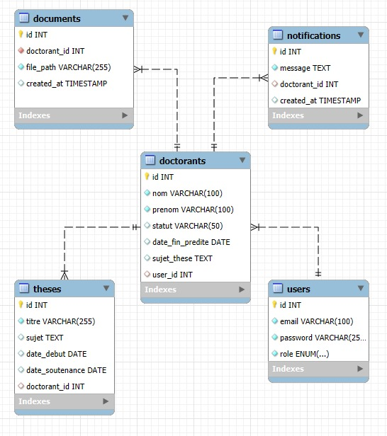

# PhD Manager

Web app to manage PhD students at a school: student profiles, theses, documents and notifications, with separate views for administrators and PhD students.

## Context

Academic group project at EMINES (UM6P), October 2024 to March 2025. The repository was initialized by a teammate ([LightnninGG](https://github.com/LightnninGG)); the application code (React frontend, Express API, MySQL schema) was then pushed from my account.

The original project report (in French) is in [docs/report_fr.pdf](docs/report_fr.pdf).

## What it does

- **Login with roles**: email and password, passwords hashed with bcrypt, JWT issued on login. Admins and PhD students see different menus.
- **Student and thesis management** (admin): add PhD students (this also creates their user account), add theses linked to a student, list both.
- **Documents**: students upload files (PDF, Word, images, up to 5 MB, handled with Multer); admins see and open all uploaded documents.
- **Notifications**: admins send a message to all students or to a selection; each student sees their own notifications.
- **Dashboard** (admin): number of students (active / suspended), theses in progress and defended.

Stack: React 18, Tailwind CSS, Node.js / Express, MySQL (`mysql2`), JWT, bcrypt, Multer.

## Data model



*MySQL schema: users, PhD students, theses, documents and notifications. The SQL script is in [database/schema.sql](database/schema.sql).*

## Screenshots


*Login page (email and password, JWT issued by the API).*

## Running it locally

Requirements: Node.js 16+, MySQL.

```bash
git clone https://github.com/RedaMohssine/Phd_Manager.git
cd Phd_Manager
npm install

# create the database and tables
mysql -u root -p < database/schema.sql

# backend configuration
cp backend/.env.example backend/.env   # then edit the values
```

Create a first admin account (the app has no sign-up page):

```bash
node -e "require('bcrypt').hash('your-password', 10).then(console.log)"
mysql -u root -p gestion_doctorants -e "INSERT INTO users (email, password, role) VALUES ('admin@example.com', '<hash>', 'admin');"
```

Then start the API (port 5000) and the React app (port 3000) together:

```bash
npm run dev
```

## Repository structure

```
backend/server.js     Express API (auth, students, theses, documents, notifications, stats)
backend/uploads/      uploaded files (not versioned)
database/schema.sql   MySQL tables
src/App.js            login, sidebar and role-based routing
src/components/       one component per view (dashboard, students, theses, documents, notifications)
docs/report_fr.pdf    project report (French)
```

## Limitations

- The JWT is created at login but the API routes do not check it yet, so the backend is not protected on its own.
- The API URL (`http://localhost:5000`) is hard-coded in the components instead of being configurable.
- Students cannot be edited or deleted from the UI, and some IDs are adjusted by hand (`id - 1`) between `users` and `doctorants`, which should be replaced by a proper join on `user_id`.
